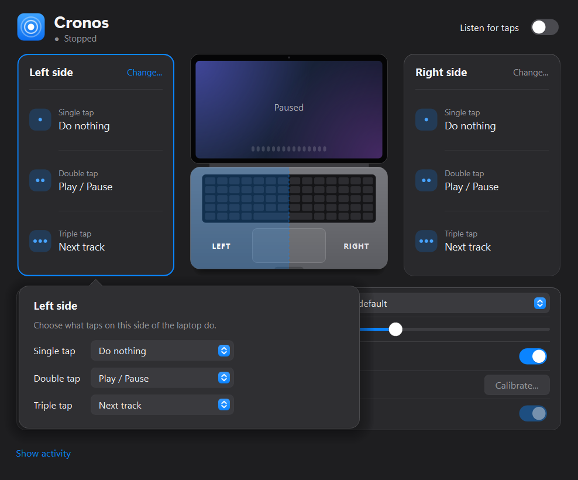
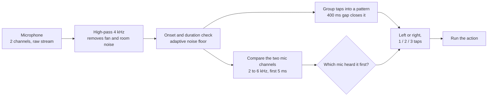

<h1 align="center">Cronos </h1>

<p align="center">
  <b>Tap your laptop to control it.</b><br>
  Tap the palm rest and Cronos hears it through the built-in microphone, works out which side you tapped and how many times, and runs the action you chose.
</p>

<p align="center">
  
  
  
  <a href="LICENSE"></a>
</p>

<p align="center">
  
</p>

## What it does

| You do | Cronos does |
|---|---|
| Tap once, twice or three times on the **left** palm rest | Runs the action you set for that pattern on the left |
| Tap once, twice or three times on the **right** palm rest | Runs the action you set for that pattern on the right |

That is 6 slots (3 patterns × 2 sides). Each one can be:

- a media key: **Play / Pause, Next, Previous, Mute, Volume up, Volume down**
- **Open an app**: pick anything from your Start menu, Store apps included
- **Close the app in front**: the same as clicking its X
- **Press a shortcut**: any key combination, for example `Ctrl+Shift+M`
- **Run a command**
- or do nothing

Out of the box a double tap plays or pauses and a triple tap skips to the next track, on both sides.

## Why it is more than a loudness trigger

A palm rest tap sounds like a lot of other things: a key press, a mouse click, a cough, a word. Cronos handles that in seven steps.



- **Raw capture.** Windows' own noise suppression is built to remove exactly this kind of sound, so Cronos asks the driver for the raw stream when it can.
- **Above 4 kHz.** Taps are broadband clicks 15 to 20 ms long, while the microphone's noise is low-frequency. Looking only above 4 kHz made taps 7 to 32 times louder than the noise, instead of 4 to 9.
- **Left or right from timing.** Laptops with a microphone array deliver two channels. A tap on the left reaches the left microphone a fraction of a millisecond before the right one (about 2 samples at 48 kHz). Cronos measures that gap by comparing the two channels between 2 and 6 kHz.
- **Typing is ignored.** Taps that coincide with a keystroke or mouse click are dropped, and so is a pattern that is still open when input arrives.
- **Only short sounds from the palm rests.** A tap lasts 5 to 25 ms, so anything louder for more than 30 ms (a spoken word, a cough, a scrape, something put down) is not one. And once you have pressed **Calibrate...**, Cronos knows the timing gap of each palm rest and ignores sounds that match neither, such as something in front of the laptop or far off to one side.
- **A tap shakes the laptop.** Along with its click, a tap makes a thump below 300 Hz, because the chassis itself moves. A slap or a clap in the room arrives through the air as the click alone. After **Calibrate...**, Cronos listens 20 ms for the thump and ignores a loud click that comes without one.
- **A tap makes the laptop ring.** The chassis rings at 13 to 16 kHz when it is tapped. Speech and cracked knuckles reach the microphone through the air without that ring, and most of them sit at 3 to 9 kHz. After **Calibrate...**, Cronos ignores sounds below 12.5 kHz.

### How well it works

Tuned and checked against recordings of real taps on one laptop (Realtek microphone array):

- Replayed at the default sensitivity, all 59 recorded single taps and 10 double taps, soft and hard, come out with the right count on the correct side.
- Two recordings hold the sounds that used to set it off: a hand slapped on a shoulder, a bottle put down, coughing, walking about, 30 seconds of talking, cracked knuckles. Across all four recordings, at the default sensitivity, sounds other than taps fired 49 actions with none of the checks, 12 before the ring check and 3 now. No real tap is lost at the default sensitivity (at one other setting, one very soft tap is).
- What still gets through is a quiet sound from the direction of a palm rest, such as a hand brushing it: the room's own rumble hides whether it had a thump, and a light touch on the chassis makes it ring.
- The checks are set from this one laptop's recordings (`sideTolerance`, a thump of at least -14 dB, a ring of at least 12.5 kHz). They rest on five loud slaps and one person's speech.
- Lowering **Sensitivity** cuts stray sounds further, at the cost of soft taps: at the lowest settings about one soft tap in five is not heard.
- A pattern is acted on about 0.4 s after your last tap, because Cronos waits to see whether another tap follows.

It has not been measured on other laptops. Microphone spacing and chassis differ, so the numbers above may need adjusting there (see [Tuning](#tuning)).

## Requirements

- Windows 10 or 11
- A built-in or USB microphone. **Left and right need a microphone array with two channels**; with a single microphone every tap counts as left.

## Build and run

Needs Qt 6 (built and tested with Qt 6.11.2, MinGW 13.1) and CMake. The quickest way is to open `CMakeLists.txt` in Qt Creator and press Run.

From a terminal, with the Qt and MinGW `bin` folders on your `PATH`:

```bat
cmake -S . -B build -G Ninja
cmake --build build
build\cronos.exe
```

Run the tests:

```bat
ctest --test-dir build --output-on-failure
```

Two tests run: the tap detector on synthetic audio, and the side popovers of the window.

## Install it

To use Cronos every day without Qt Creator, run this once from the project folder (and again after changing the code):

```bat
powershell -ExecutionPolicy Bypass -File install.ps1
```

It builds the release version and, for your Windows user only:

- copies the app and the Qt files it needs to `%LOCALAPPDATA%\Programs\Cronos`
- adds **Cronos** to the Start menu
- makes Windows start it when you sign in, hidden in the tray

The paths to Qt at the top of [`install.ps1`](install.ps1) are the Qt installer's defaults; change them if yours differ. **Start when I sign in to Windows** in the app switches the automatic start off and on. Only one copy runs at a time: starting Cronos again shows the window of the copy that is already running, so quit that one from the tray before pressing Run in Qt Creator.

## Using it

1. Switch on **Listen for taps**.
2. Click the **Left side** or **Right side** tile (or that half of the laptop drawing) and choose an action for each pattern.
3. Tap. The matching half of the drawing lights up, and the laptop's screen shows the last pattern and the microphone level.

**Show activity** at the bottom opens a log with every sound's strength, left/right measurement and thump, and the reason when one was ignored. It is the first thing to look at if something is misdetected.

Settings are saved in `%APPDATA%\cronos\cronos.ini`.

## Tuning

If sensitivity is off, use the **Sensitivity** slider. Press **Calibrate...** once on a new laptop: five taps on the left, five on the right. It fixes left and right if they are swapped or unreliable, and it switches on the three checks that ignore other sounds: the direction of the palm rests, the thump and the ring. The remaining knobs are in `TapConfig` at the top of [`tapdetector.h`](tapdetector.h), each with a comment on what it does.

The [`tuning/`](tuning) folder holds the tools used to tune the detector against recordings instead of by guessing:

| Tool | Does |
|---|---|
| `rec.cpp` | Records the microphone exactly as the app hears it |
| `replay.cpp` | Runs the app's detector over a recording and prints every tap |
| `sweep.cpp` | Scores a grid of left/right settings against a labelled recording |
| `explore.cpp` | Compares other ways of telling the sides apart |

## Project layout

| File | Role |
|---|---|
| [`tapdetector.h`](tapdetector.h) | The detection maths. Plain C++, no Windows or Qt, so it is testable offline |
| [`tapengine.cpp`](tapengine.cpp) | Microphone capture on its own thread (WASAPI) |
| [`mainwindow.cpp`](mainwindow.cpp) | Window, tray icon, actions, calibration, settings |
| [`widgets.h`](widgets.h) | The custom-drawn parts: laptop drawing, tiles, settings card, popover, switch. Follows Windows light and dark mode |
| [`install.ps1`](install.ps1) | Builds the release version and installs it for the current user |
| [`cronos.rc`](cronos.rc), [`docs/images/cronos.ico`](docs/images/cronos.ico) | The icon of `cronos.exe` |
| [`detector_test.cpp`](detector_test.cpp), [`ui_test.cpp`](ui_test.cpp) | The tests |
| [`tap-detection-app.md`](tap-detection-app.md) | Design notes |
| [`trial.cpp`](trial.cpp) | The first throwaway prototype, kept for history |

## Roadmap

The full checklist is in [`steps.md`](steps.md). Not built yet:

- [ ] A download that installs without building from source
- [ ] Telling a quiet stray sound from a quiet tap when both come from a palm rest's direction
- [ ] Tap strength (soft vs hard) as a separate pattern
- [ ] Tap-and-hold (a held finger makes no sound, so this needs another sensor)
- [ ] Testing on more laptops

## Privacy

Audio is analysed live on your computer and thrown away. Nothing is recorded, saved or sent anywhere, and the app makes no network connections. (The recording tool in `tuning/` only writes a file when you run it yourself.)

## License

[MIT](LICENSE)
